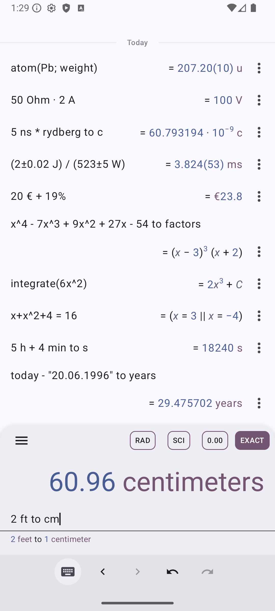
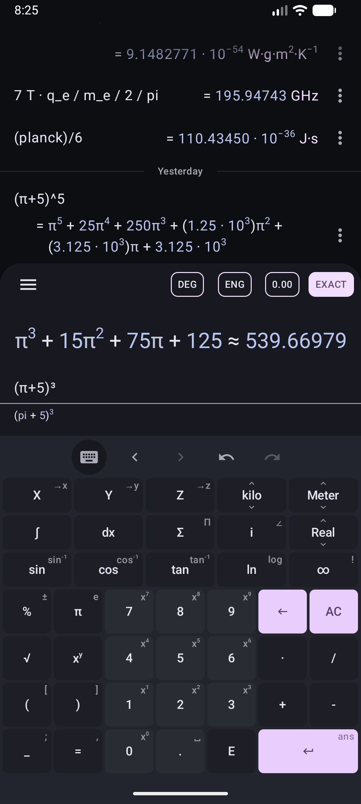
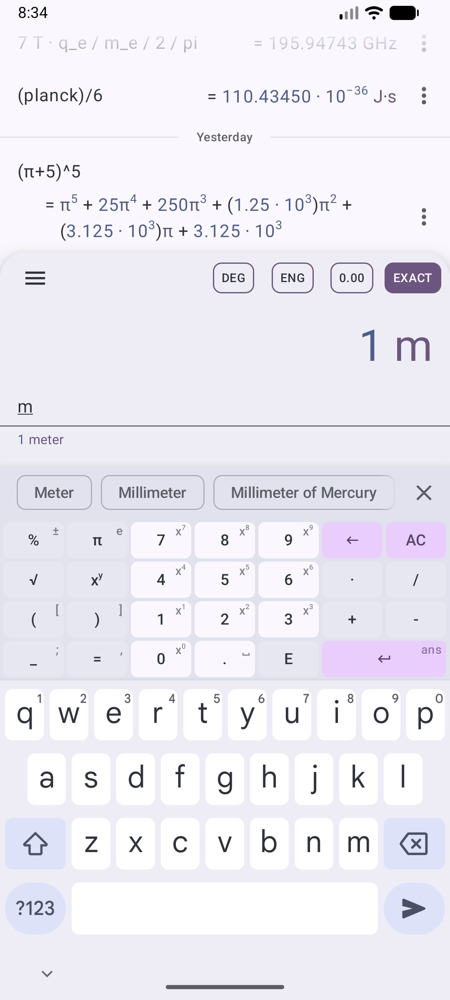

<p align="center"><a href="https://github.com/jherkenhoff/qalculate-android"></a></p> 
<h1 align="center">
  Qalculate! for Android
</h1>
<!-- description -->
<p align="center">
  <strong>~ Powerful and versatile multi-purpose calculator for the Android platform ~</strong>
    <br />
    <a href="https://github.com/jherkenhoff/qalculate-android/issues/new">Report Bug</a>
    ·
    <a href="https://github.com/jherkenhoff/qalculate-android/issues/new">Request Feature</a>
</p>
Android UI of the almighty <a href="https://qalculate.github.io">Qalculate!</a> calculator. It is simple to use but provides power and versatility normally reserved for complicated math packages, as well as useful tools for everyday needs (such as currency conversion and percent calculation). Features include a large library of customizable functions, unit calculations and conversion, symbolic calculations (including integrals and equations), arbitrary precision, uncertainty propagation, interval arithmetic, and a user-friendly interface.

<br/>
<br/>
<p align="center">
  <a href="fastlane/metadata/android/en-US/images/phoneScreenshots/1.png">
    
  </a>
  <a href="fastlane/metadata/android/en-US/images/phoneScreenshots/2.png">
    
  </a>
  <a href="fastlane/metadata/android/en-US/images/phoneScreenshots/3.png">
    
  </a>
  <a href="fastlane/metadata/android/en-US/images/phoneScreenshots/4.png">
    
  </a>
</p>

# Download

[](https://f-droid.org/packages/com.jherkenhoff.qalculate/)
[](https://github.com/jherkenhoff/qalculate-android/releases/latest)

> [!WARNING]
> This project supports an open and independent Android ecosystem and will not participate in Google's efforts to further lock-down Android. As a result, this app may not install on many devices starting September 2026. More information: https://keepandroidopen.org/

# Compiling

```
git clone https://github.com/jherkenhoff/qalculate-android
cd qalculate-android
./gradlew assembleDebug
```

## Features
Specific to qalculate-android:

* Platform-Native Graphical user interface
* Simple default view
* Optional calculate-as-you-type mode

From libqalculate:

* Calculation and parsing
* Result display
* Symbolic calculation
* Functions
* Units
* Variables and constants
* Plotting
* and more...

_For more details about the syntax, and available functions, units, and variables, please consult the [manual](https://qalculate.github.io/manual/)_.

## Contributors

<!-- ALL-CONTRIBUTORS-LIST:START - Do not remove or modify this section -->
<!-- prettier-ignore-start -->
<!-- markdownlint-disable -->
<table>
  <tbody>
    <tr>
      <td align="center" valign="top" width="14.28%"><a href="https://github.com/jherkenhoff"><br /><sub><b>jherkenhoff</b></sub></a><br /><a href="#code-jherkenhoff" title="Code">💻</a></td>
      <td align="center" valign="top" width="14.28%"><a href="https://www.bytehamster.com"><br /><sub><b>ByteHamster</b></sub></a><br /><a href="#code-ByteHamster" title="Code">💻</a></td>
      <td align="center" valign="top" width="14.28%"><a href="https://github.com/keinezeit8"><br /><sub><b>keinezeit8</b></sub></a><br /><a href="#doc-keinezeit8" title="Documentation">📖</a></td>
      <td align="center" valign="top" width="14.28%"><a href="https://play.google.com/store/apps/details?id=com.inidamleader.ovtracker"><br /><sub><b>Inidam Leader</b></sub></a><br /><a href="#code-inidamleader" title="Code">💻</a></td>
      <td align="center" valign="top" width="14.28%"><a href="http://hoverth.github.io"><br /><sub><b>Thomas Dickson</b></sub></a><br /><a href="#code-Hoverth" title="Code">💻</a></td>
      <td align="center" valign="top" width="14.28%"><a href="https://github.com/Poussinou"><br /><sub><b>Poussinou</b></sub></a><br /><a href="#doc-Poussinou" title="Documentation">📖</a></td>
      <td align="center" valign="top" width="14.28%"><a href="https://squ1dd13.ink"><br /><sub><b>Alex</b></sub></a><br /><a href="#code-squ1dd13" title="Code">💻</a></td>
    </tr>
    <tr>
      <td align="center" valign="top" width="14.28%"><a href="https://github.com/Maimas2"><br /><sub><b>Maimas2</b></sub></a><br /><a href="#code-Maimas2" title="Code">💻</a></td>
      <td align="center" valign="top" width="14.28%"><a href="https://github.com/yonatan8070"><br /><sub><b>Yonatan Avhar</b></sub></a><br /><a href="#bug-yonatan8070" title="Bug reports">🐛</a></td>
    </tr>
  </tbody>
</table>

<!-- markdownlint-restore -->
<!-- prettier-ignore-end -->

<!-- ALL-CONTRIBUTORS-LIST:END -->
